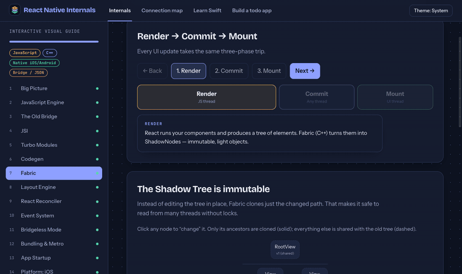
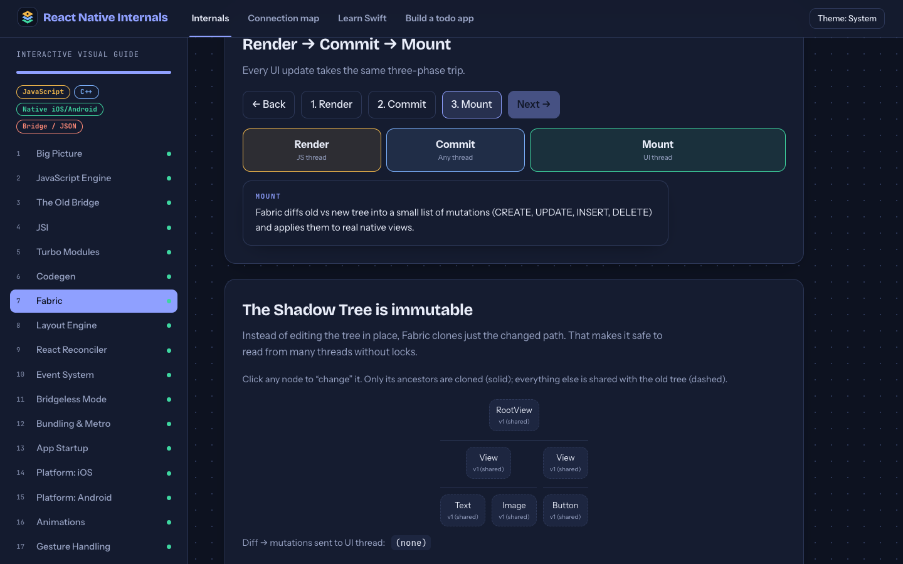
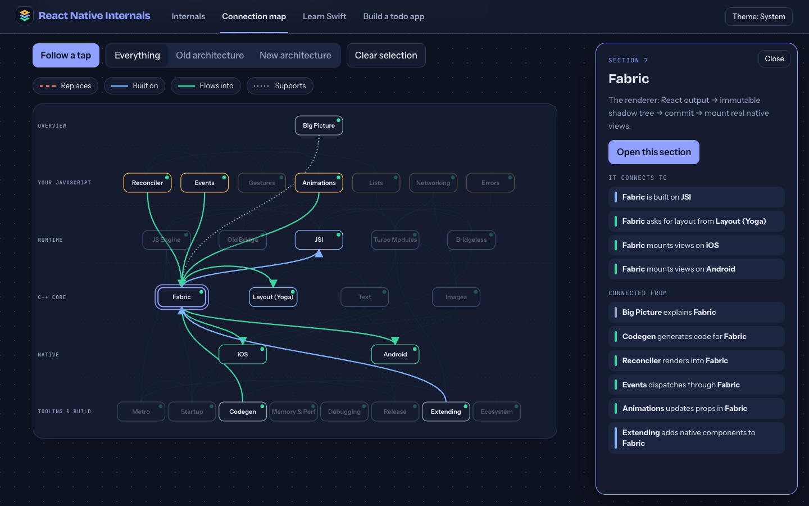
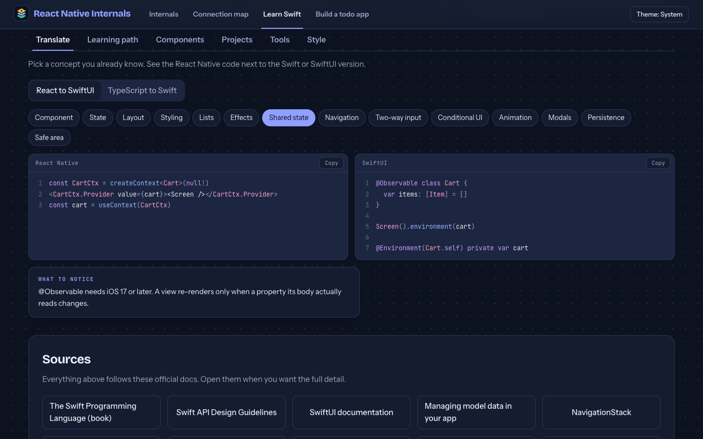
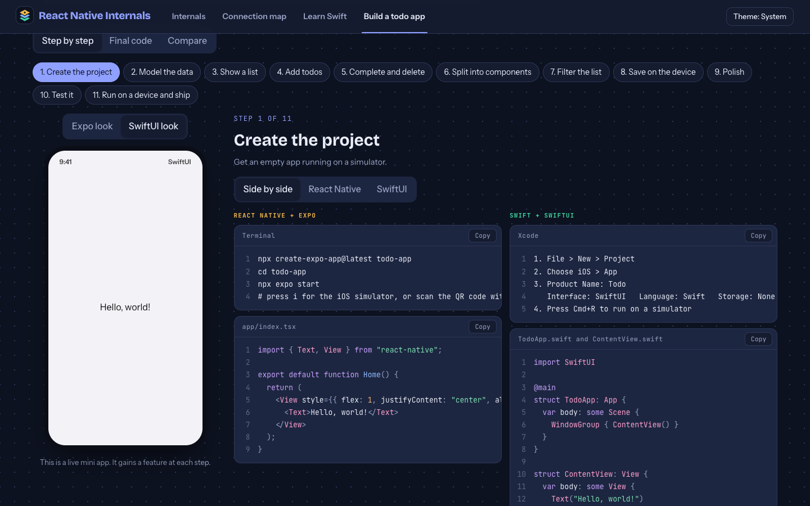
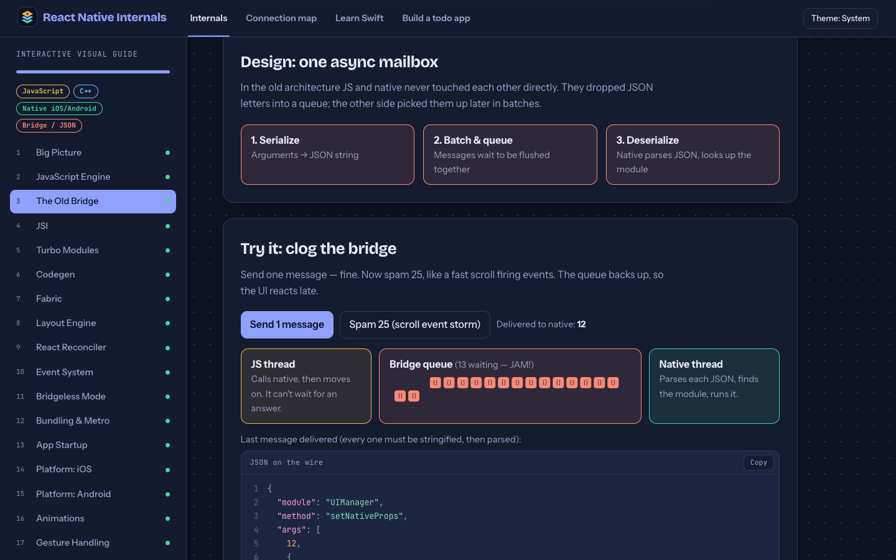
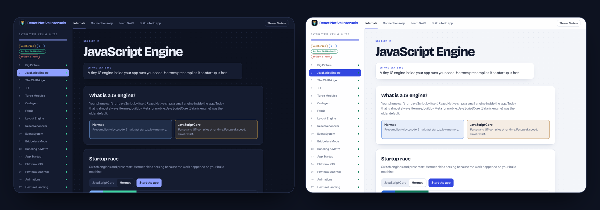
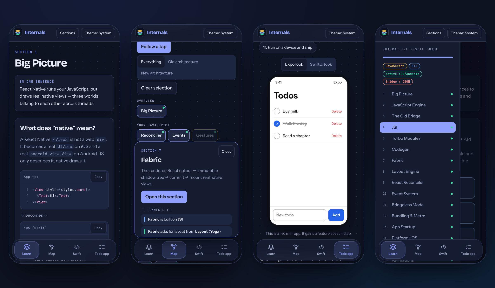

<div align="center">


# React Native Internals

### An interactive, visual guide to what really happens under the hood of React Native.

27 hands-on lessons, a map that connects them all, and a Swift and SwiftUI track for React Native engineers. Click, drag, step through and break things instead of just reading about them.

<br />


<br />

[**Take the tour**](#take-the-tour) · [**What's inside**](#whats-inside) · [**Quick start**](#quick-start) · [**All 27 lessons**](#the-27-lessons) · [**Contribute**](#adding-content)

<br />



<sub>A 35 second tour: a lesson demo, the connection map, the Swift track and the todo builder.</sub>

</div>

<br />

## Why this exists

React Native feels like magic until something breaks. Why did a tap take 200 ms? Why does `useNativeDriver` matter? What is JSI, and why did the bridge go away?

The answers live in a stack of ideas (JavaScript engines, C++ cores, native views, threads) that are hard to picture from text alone. This project turns each one into a small interactive demo you can poke at, so the mental model sticks.

It is built for **React Native engineers who want to understand the platform they work on**, and for the ones who want to **learn Swift and SwiftUI** next.

<br />

## Take the tour

Four areas, one header. Everything works on desktop and phone.

<table>
  <tr>
    <td width="50%" valign="top">
      <a href="#the-27-lessons"></a>
      <h4>1. Internals: 27 interactive lessons</h4>
      <p>From the JavaScript engine to the release pipeline. Every lesson opens with a one-sentence summary and a demo you can drive: race Hermes against JSC, jam the old bridge, step through Render, Commit and Mount.</p>
    </td>
    <td width="50%" valign="top">
      <a href="#the-connection-map"></a>
      <h4>2. Connection map</h4>
      <p>All 27 topics on one page, laid out by layer. Select a node and see what it builds on and what builds on it. Press <b>Follow a tap</b> to watch one touch travel from the screen to the native view.</p>
    </td>
  </tr>
  <tr>
    <td width="50%" valign="top">
      <a href="#the-swift-track"></a>
      <h4>3. Swift and SwiftUI track</h4>
      <p>Written for someone who already knows React. Translate concepts side by side, follow a nine-stage learning path, build twelve components, and tick off six projects.</p>
    </td>
    <td width="50%" valign="top">
      <a href="#build-a-todo-app-twice"></a>
      <h4>4. Build a todo app, twice</h4>
      <p>One app in eleven steps, built with React Native and Expo on one side and Swift and SwiftUI on the other. A live phone preview gains a feature at every step.</p>
    </td>
  </tr>
</table>

<br />

## What's inside

### The color language

Every diagram uses the same four colors, so you always know which world you are looking at.


### Interactive demos, not screenshots of demos

<table>
  <tr>
    <td width="50%"></td>
    <td width="50%" valign="top">
      <h4>Break the old bridge</h4>
      <p>Send one message, then spam 25 like a fast scroll. Watch the queue back up and see the exact JSON that crosses the boundary.</p>
      <h4>Try the same idea on the new one</h4>
      <p>The JSI lesson races a bridge call against a direct synchronous call, hop by hop.</p>
      <blockquote>Press a button, see a consequence. That loop is the whole teaching method.</blockquote>
    </td>
  </tr>
</table>

### Built to be studied

- **Progress that remembers you.** Visited lessons get a green dot. Swift topics, project milestones and todo-app steps can be ticked off. Everything is saved in your browser, nothing is sent anywhere.
- **Dark and light themes.** Follows your system by default, switch any time from the header.
- **Code you can copy.** Syntax highlighted, line numbered, with a Copy button.
- **Smooth, respectful motion.** Page transitions slide in the direction you are going. Animations are turned off for people who prefer reduced motion.
- **Keyboard friendly.** Visible focus states, semantic buttons, and Escape closes the map panel.

<div align="center">



</div>

<br />

## The 27 lessons

Open any row to see what you can do in that lesson. They run in a sensible order, but each one stands alone.

<details>
<summary><b>Show all 27 lessons and their demos</b></summary>

<br />

| #   | Lesson                | Try this                                                                                             |
| --- | --------------------- | ---------------------------------------------------------------------------------------------------- |
| 1   | **Big Picture**       | Toggle Old and New architecture, send a tap down the stack, step one tap across the threads          |
| 2   | **JavaScript Engine** | Race Hermes against JavaScriptCore at startup, run a garbage collection pass                         |
| 3   | **The Old Bridge**    | Clog the bridge with 25 messages and inspect the JSON on the wire                                    |
| 4   | **JSI**               | Race a bridge call against a JSI call, hover the HostObject to HostFunction chain                    |
| 5   | **Turbo Modules**     | Compare eager and lazy module loading, try sync and async methods                                    |
| 6   | **Codegen**           | See a spec become C++, Objective-C and Kotlin, then break a type and trigger a build error           |
| 7   | **Fabric**            | Step Render, Commit, Mount, clone the shadow tree, toggle view flattening                            |
| 8   | **Layout Engine**     | Flexbox playground and a text-measuring slider                                                       |
| 9   | **React Reconciler**  | Walk the Fiber tree, interrupt a transition with an urgent update, compare batching                  |
| 10  | **Event System**      | Follow a tap through capture, target and bubble                                                      |
| 11  | **Bridgeless Mode**   | Remove the bridge, add tasks to the RuntimeScheduler by priority                                     |
| 12  | **Bundling & Metro**  | Step through resolve, transform and serialize, see what Fast Refresh re-runs, toggle inline requires |
| 13  | **App Startup**       | Scrub through the launch timeline from process start to first screen                                 |
| 14  | **Platform: iOS**     | Follow `main()` to your first view, apply UIKit mutations                                            |
| 15  | **Platform: Android** | Application to Views, map Java types through JNI, run a Gradle build                                 |
| 16  | **Animations**        | Block the JS thread and watch the native driver keep going, LayoutAnimation, Reanimated worklets     |
| 17  | **Gesture Handling**  | Compare responder and Gesture Handler paths, drive a gesture state machine, compose gestures         |
| 18  | **Lists**             | Scroll a windowed list, see cell recycling save views                                                |
| 19  | **Text Rendering**    | Toggle styles and see the attributed string, resize text and watch it reflow                         |
| 20  | **Images & Assets**   | Pick a pixel ratio, load an image twice to see caching, calculate decoded memory                     |
| 21  | **Networking**        | Trace `fetch`, drive a WebSocket, compare Blob handles with base64, compare storage options          |
| 22  | **Memory**            | Allocate in three worlds, cause a leak, raise frame cost until frames drop                           |
| 23  | **Debugging**         | Read real CDP messages, compare LogBox and RedBox, inspect a view                                    |
| 24  | **Error Handling**    | Choose where an error starts and see what catches it                                                 |
| 25  | **Build & Release**   | Source to bytecode, symbolicate a crash, see when an OTA update applies                              |
| 26  | **Extending RN**      | Pick what to build, swap the platform layer under React                                              |
| 27  | **Ecosystem**         | Community CLI vs Expo CLI, Expo Modules, autolinking                                                 |

</details>

<br />

## The connection map

The map answers a question the individual lessons cannot: _how do all of these fit together?_

- Boxes are grouped in six layers, from **Your JavaScript** down to **Native**, with tooling underneath.
- Lines come in four kinds: **Replaces**, **Built on**, **Flows into** and **Supports**. Toggle any kind on or off.
- Select a box to light up its connections. The side panel lists every link as a plain sentence, such as _"Codegen generates code for Fabric"_.
- Switch to **Old architecture** or **New architecture** to fade out the other side.
- On a phone the diagram becomes a grouped list with the same highlighting and a bottom sheet.

<br />

## The Swift track

A dedicated page for React Native engineers who want to learn Swift and SwiftUI. Content was checked against the official Swift book (Swift 6.4) and Apple's SwiftUI and SwiftData documentation.

| Tab               | What you get                                                                                                                |
| ----------------- | --------------------------------------------------------------------------------------------------------------------------- |
| **Translate**     | 14 React-to-SwiftUI pairs and 11 TypeScript-to-Swift pairs, side by side, each with a "what to notice" note                 |
| **Learning path** | 9 stages and 55 topics, from `let` and `var` to TestFlight. Tick topics off as you go, each shows its React Native analogue |
| **Components**    | 12 components to build by hand, from a button style to a draggable card, each with working starter code                     |
| **Projects**      | 6 projects from a weekend tip splitter to an expense tracker capstone, each with milestones                                 |
| **Tools**         | What replaces npm, Metro, Jest, Flipper and EAS in the Swift world, plus a setup checklist                                  |
| **Style**         | 8 avoid and prefer Swift habits, a live demo of why modifier order matters, and design rules for a native feel              |

<br />

## Build a todo app, twice

Eleven steps, from an empty project to TestFlight. Each step shows both versions next to each other.

|     | Step                  | React Native + Expo        | Swift + SwiftUI                     |
| --- | --------------------- | -------------------------- | ----------------------------------- |
| 1   | Create the project    | `create-expo-app`          | Xcode new project                   |
| 2   | Model the data        | A TypeScript type          | An `@Observable` class              |
| 3   | Show a list           | `FlatList`                 | `List`                              |
| 4   | Add todos             | `useState` and `TextInput` | `@State` and `TextField`            |
| 5   | Complete and delete   | Immutable updates          | In-place changes and `.onDelete`    |
| 6   | Split into components | `TodoItem` and `useTodos`  | `TodoRow`                           |
| 7   | Filter the list       | Hand-built chips           | Segmented `Picker`                  |
| 8   | Save on the device    | AsyncStorage and effects   | SwiftData `@Model` and `@Query`     |
| 9   | Polish                | Reanimated and haptics     | `.animation` and `.sensoryFeedback` |
| 10  | Test it               | Jest and Testing Library   | Swift Testing                       |
| 11  | Ship it               | EAS Build and Submit       | Archive to TestFlight               |

The **Final code** tab shows every finished file for both versions, and **Compare** puts persistence, haptics, tests and platform reach next to each other, including where React Native is the better choice.

<br />

## Works on your phone

On small screens the site becomes an app: a floating tab bar that tucks away as you scroll, a Sections drawer, a list version of the map, and touch-sized controls everywhere.

<div align="center">



</div>

<br />

## Quick start

You need **Node.js 20.19+ or 22.12+** (developed on Node 24) and npm.

```bash
# 1. get the code
git clone <your-repo-url>
cd learning-react-native

# 2. install
npm install

# 3. run it
npm run dev
```

Open the address Vite prints (usually `http://localhost:5173`). Pages live at `/#/big-picture`, `/#/map`, `/#/swift` and `/#/todo`, so you can link straight to any of them.

<details>
<summary><b>All scripts</b></summary>

<br />

| Command                | What it does                                 |
| ---------------------- | -------------------------------------------- |
| `npm run dev`          | Start the dev server with hot reload         |
| `npm run build`        | Type-check with `tsc`, then build to `dist/` |
| `npm run preview`      | Serve the production build locally           |
| `npm run lint`         | Lint with oxlint                             |
| `npm run format`       | Format everything with Prettier              |
| `npm run format:check` | Check formatting without changing files      |

The site uses hash routing, so `dist/` can be hosted on any static host with no server rewrites.

</details>

<br />

## How it is built

<table>
  <tr>
    <td><b>React 19 + TypeScript</b></td>
    <td>Every lesson is a small component. Strict types keep the content data honest.</td>
  </tr>
  <tr>
    <td><b>Vite</b></td>
    <td>Fast dev server and a small static build.</td>
  </tr>
  <tr>
    <td><b>Framer Motion</b></td>
    <td>Layout animations, spring physics, shared-element highlights and page transitions.</td>
  </tr>
  <tr>
    <td><b>React Router (hash)</b></td>
    <td>Deep links that work on any static host.</td>
  </tr>
  <tr>
    <td><b>prism-react-renderer</b></td>
    <td>Syntax highlighting for TypeScript, Swift, Kotlin, C++, Objective-C and JSON, themed with CSS variables so it follows light and dark.</td>
  </tr>
  <tr>
    <td><b>Plain CSS with tokens</b></td>
    <td>One <code>theme.css</code> with design tokens for both themes. No UI framework.</td>
  </tr>
  <tr>
    <td><b>Prettier + oxlint</b></td>
    <td>Consistent formatting and fast linting.</td>
  </tr>
</table>

There is no backend and no tracking. The only things stored are your progress and theme, in `localStorage`.

<details>
<summary><b>Project structure</b></summary>

<br />

```text
learning-react-native/
├── index.html                 App shell, fonts, icons, manifest
├── public/                    Favicon, app icons, web manifest
├── docs/                      README screenshots and the tour GIF
└── src/
    ├── App.tsx                Routes
    ├── main.tsx               Entry point
    ├── components/
    │   ├── Shell.tsx          Header, sidebar, floating tab bar, page transitions
    │   ├── Logo.tsx           The three-layer mark
    │   └── ui.tsx             Shared pieces: Block, Seg, Stepper, Code, Chip
    ├── data/
    │   ├── curriculum.ts      The 27 lessons: title, summary, topics
    │   ├── relations.ts       Map layout and every connection between lessons
    │   ├── swiftData.ts       Content for the Swift track
    │   └── todoSteps.ts       The eleven todo-app steps and final code
    ├── sections/
    │   ├── S01BigPicture.tsx  One file per lesson (S01 to S27)
    │   ├── registry.ts        Maps a lesson id to its component
    │   ├── Page.tsx           Generic lesson page (hero, body, pager)
    │   ├── MapPage.tsx        Connection map
    │   ├── SwiftPage.tsx      Swift track
    │   └── TodoPage.tsx       Todo-app walkthrough
    └── styles/theme.css       Tokens, layout, components, mobile rules
```

</details>

<br />

## Adding content

Everything is data plus small components, so extending it is quick.

<details>
<summary><b>Add a new lesson</b></summary>

<br />

1. **Describe it** in `src/data/curriculum.ts`: an `id`, a title, a one-sentence summary, a list of topics, and `ready` set to `true`.
2. **Build the demo** in `src/sections/S28YourLesson.tsx`. Export a default component made of `Block` sections from `components/ui.tsx`. Use `Seg`, `Stepper` and `Code` for the usual controls.
3. **Register it** in `src/sections/registry.ts` by adding `'your-id': S28`.
4. **Connect it** in `src/data/relations.ts`: add a node to the layout list and edges that read as sentences, such as `e('your-id', 'jsi', 'is built on', 'B')`.

The sidebar, page header, previous and next buttons, progress tracking and map all pick it up from that data.

</details>

<details>
<summary><b>Write a good lesson</b></summary>

<br />

- Start with one sentence a newcomer can repeat.
- One idea per demo. If you need a second idea, add a second `Block`.
- Make the user press something. A demo that only plays is a video.
- Use the color language: yellow for JavaScript, blue for C++, green for native, red for the old bridge.
- Keep numbers honest. If a value is illustrative, say so in the text.
- Check it at phone width. Controls should wrap, and nothing should scroll sideways.

</details>

<details>
<summary><b>Edit the Swift track or the todo walkthrough</b></summary>

<br />

Both are driven by data. Edit `src/data/swiftData.ts` for translations, stages, components, projects, tools and style rules, or `src/data/todoSteps.ts` for the todo steps and final files. Code samples are plain strings, so they stay exactly as written.

</details>

Before you open a pull request, run:

```bash
npm run format && npm run lint && npm run build
```

<br />

## How accurate is it?

- The internals lessons are teaching models. They simplify real systems on purpose, and numbers in demos (startup times, bundle sizes, memory) are **illustrative, not benchmarks**. When you need exact behavior, read the official [React Native architecture docs](https://reactnative.dev/architecture/overview).
- The Swift track was checked against the [Swift book](https://docs.swift.org/swift-book/) and Apple's [SwiftUI](https://developer.apple.com/documentation/swiftui) and [SwiftData](https://developer.apple.com/documentation/swiftdata) documentation. `@Observable` and SwiftData need iOS 17 or later, and `NavigationStack` needs iOS 16 or later.
- The Swift and Expo code samples were **not compiled or run** as part of this project. Treat them as carefully written starting points, and expect to fix a small thing or two when you paste them into Xcode or an Expo app.

If you spot something wrong, please open an issue. Corrections are the most useful contribution.

<br />

## Ideas for what comes next

- A short quiz at the end of each lesson
- Richer one-line summaries for the later lessons
- A Kotlin and Jetpack Compose track to mirror the Swift one
- Deep links from the map to a specific demo inside a lesson
- A hosted version

<br />

## License

This project is released under the [MIT License](LICENSE). You are free to use, copy, modify and share it, including in your own courses and teaching material, as long as the license notice stays with it.

**Contributing:** by opening a pull request you agree that your contribution is licensed under the same MIT License.

The Google Fonts used by the site (Bricolage Grotesque, Instrument Sans and JetBrains Mono) are loaded from Google and keep their own open-source licenses. Dependencies keep theirs too.

<br />

<div align="center">


<sub>Built to make the invisible parts of React Native visible.</sub>

</div>
